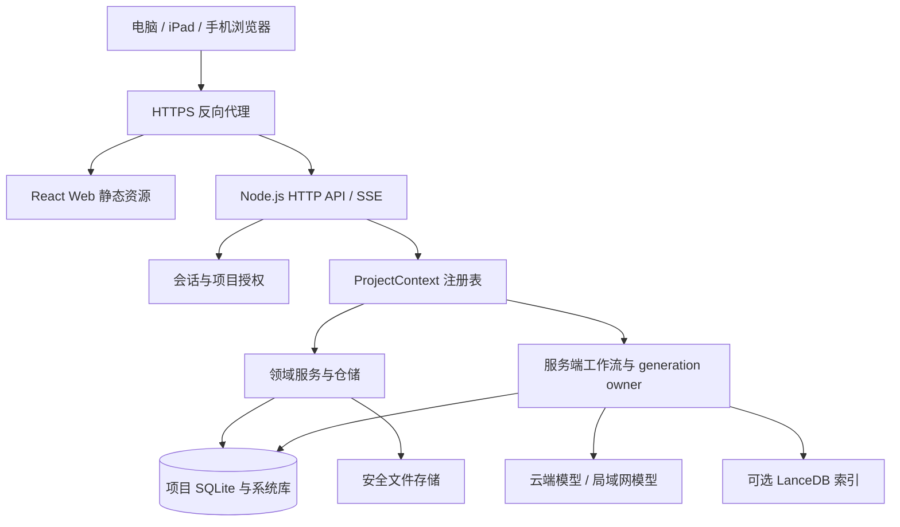

# 系统设计提案

本篇定义共享核心与小说工作区。媒体、改编、剪辑与 3D 架构由 [全流程设计](06-novel-to-film.md) 扩展，NAS 核心仍为单实例，媒体 worker 可独立部署。

## 目标架构

首版单实例，API 与任务调度属于一个应用部署单元。CPU 密集的解压、解析、索引放入工作线程或受控子进程；数据库写入保持明确的所有者与短事务。不要让多个服务副本同时扫描并领取同一套任务。

建议独立 apps/web、apps/server，逐步抽取 packages/contracts、core、storage、platform；这是目标组织，不要求先机械移动全仓。先用依赖注入得到一条可测试的垂直链路，随后拆包。可选择轻量 TypeScript HTTP 框架，具体版本在原型兼容测试后固定。

## 项目与会话

Web 登录 session、客户端 editorSessionId、项目 projectId、工作流 executionEpoch 是不同概念。浏览器重连不能随意递增整个项目 epoch，使其他设备和后台任务失效。

ProjectContext 包含数据库、受控文件根、知识库句柄、generation owner、资源锁和运行代次。请求经登录授权后，由服务器以 projectId 查找上下文；不能接受客户端绝对路径作为授权依据。

上下文可按容量淘汰，但只在无在途请求、无运行任务、无待提交事务时关闭；引用计数与任务引用要一起检查。项目删除、恢复、迁移必须先进入独占维护状态，停止新写入，等待或取消任务，再释放资源。

## 接口示例（新增设计）

结合 Reveric 源码调研后的细化见 [整合优化](05-reveric-integration.md)：人工保存、AI 应用、恢复和导入统一走领域命令；同事务记录 revision、幂等收据、审计和 outbox。跨设备审批持久化并采用一次性条件更新，不用内存等待对象作为最终权威。

| 方法与路径 | 用途 | 核心约束 |
| --- | --- | --- |
| POST /api/v1/session | 登录 | 限速、会话轮换 |
| GET /api/v1/bootstrap | Web 启动 | 版本、能力、当前身份；不回传密钥 |
| GET /api/v1/projects | 作品列表 | 只返回授权作品 |
| GET /api/v1/projects/:p/documents/:d | 读取编辑文档 | 返回稳定文档 ID、内容、revision |
| PUT /api/v1/projects/:p/documents/:d | 自动保存 | baseRevision、mutationId、事务 CAS |
| POST /api/v1/projects/:p/runs | 启动工作流 | 来源版本、幂等键、预算校验 |
| GET /api/v1/projects/:p/runs/:r | 读取快照 | 校验作品归属 |
| GET /api/v1/projects/:p/events | SSE 事件 | 游标重连、授权、心跳 |
| POST /api/v1/projects/:p/runs/:r/cancel | 取消 | 不因断线取消；持久化取消意图 |
| POST /api/v1/imports | 导入暂存 | 大小、格式、配额和路径校验 |
| GET /api/v1/exports/:id/download | 下载导出 | 身份验证、受控文件 ID |

错误采用稳定 code、requestId 和可本地化信息。冲突为 409，未登录 401，无权限 403，版本/格式不支持给出明确业务错误。不能将任意 IPC channel、数据库 SQL 或文件路径公开为远程通用接口。

## 工作流归属与任务恢复

复用 generation-run-repository 的 run/attempt/artifact、预算和来源指纹。增加服务端调度元数据、执行租约、事件序号；避免一个通用 jobs 表另存一套互相矛盾的业务状态。

执行链：接收用户意图 → 校验并冻结来源 → 持久化执行记录 → 后台领取 → 构建上下文/调用模型/记录输出 → 来源复核 → 保存候选或领域提交 → 发布结果。

将前端 command 中的非交互步骤迁移到服务端。需要作者审批的步骤进入 awaiting_user；不要让工作流为了无人值守而自动定稿。客户端只提交意图、显示状态和发起明确审批。

断开 SSE 不取消任务。事件先获得可恢复的持久化序号，再发布；重连用 Last-Event-ID 或显式 cursor 补发，历史过期返回“需重新读取快照”。客户端按事件 ID 去重。模型 token 可合并成小批次，重要状态和完成事件必须持久化。

服务重启将失去执行租约的任务标为 interrupted，保留已持久化输出；不承诺从最后 token 精确续传。自动重试仅限有明确安全策略的操作，付费生成不静默重复调用。任务执行与最终领域提交都需幂等。

## 数据设计与兼容

保留 .ai-novel/project.db 及现有领域表；系统数据库保存用户、会话和作品注册信息。Web 专用迁移与上游 schema migration 明确分开，不修改旧 manifest 的严格字段合同。

新增编辑修订元数据、幂等收据、事件及调度元数据时，若需要与正文原子提交，应放在同一个项目数据库事务内。不要将“正文在项目库、幂等收据在系统库”当作天然原子操作。采用附加 Web 表后，桌面版往返兼容必须实测；首版只承诺副本导入与通用文稿导出，不承诺桌面数据库双向直接打开。

建议存储：/data/system、/data/projects/<id>、/data/import-staging、/data/backups。项目内部尽量保持原规范布局。索引可重建，但原始参考资料和领域数据必须备份。

恢复时导入新副本并签发独立运行身份；旧备份的 generation lease 不能继续生效。导入需验证正文、历史、人物、蓝图、引用与附件，不能只统计文件个数。

## Linux 文件层

新增 Linux 实现，保持现有“受控根目录、能力校验、原子替换、失效会话不得写入”的安全语义。单独 realpath 检查后再按字符串路径打开存在竞态，不能视为等价实现。

原型应评估 Linux 目录句柄相对访问与原生辅助程序方案；若选择限制信任模型，必须明确仅服务进程可修改数据根、拒绝符号链接和任意用户路径，并记录剩余竞态风险。目标实现需覆盖目录替换、符号链接、大小写区别、临时文件清理及磁盘满错误。

## 部署与运维

已确认目标为 Intel J5005 / x86-64、fnOS、Docker Compose。首版镜像固定 `linux/amd64`，不要求用户在 NAS 上编译前端或原生模块；在开发机/CI 构建并验证镜像，再由 Compose 拉取固定版本部署。

Compose 交付包含：应用单实例、`restart: unless-stopped`、持久化数据卷、端口与监听地址配置、健康检查、退出宽限时间、日志轮转和 `.env.example`。端口暴露方式根据最终采用的宿主机代理、容器代理或直接局域网访问确定，不预设 fnOS 内部路径与代理能力。此处是交付要求，当前没有可运行的 Web 镜像。

针对该设备，首版采用保守调度：默认同时执行 1 个生成任务，导入/索引任务各采用有界队列，避免重任务同时抢占资源；这些是可配置初值，需要实机测量。优先保证正文保存响应，重任务应让出执行资源。内存限制待确认可用内存后设置，不凭 CPU 型号推断。

方案暂按模型推理位于云端或另一台局域网主机设计，NAS 负责写作服务和请求编排；这不是用户已经确认的模型选择。若后续要求 J5005 本机推理，再单独评估模型、内存和生成延迟。

- 生产镜像独立构建 server 与 web，不依赖桌面 postinstall。先选 glibc 基础镜像验证原生模块，锁定镜像与依赖版本。
- 首版在 J5005/fnOS 的 linux/amd64 容器内验证原生模块、CPU 指令兼容和实际读写；锁文件存在包不等于目标机器可加载。ARM64 作为后续可选扩展。
- 非 root 运行；数据卷 UID/GID 匹配；不挂载 Docker socket，不赋予 NAS 管理权限。
- 同源 HTTPS，代理关闭 SSE 缓冲并配置合理超时；使用项目事件流减少连接数量。
- live 检查进程存活，ready 检查迁移状态与可服务能力；磁盘不足时拒绝写入并显式告警。
- SIGTERM 先停止接收写入/领取任务，持久化中断状态，关闭数据库；配置足够退出宽限时间。
- 升级先备份；不可逆 schema 升级回滚必须恢复对应备份，不能只回滚容器镜像。
- 备份用 SQLite 一致性机制并协调附件快照；做恢复演练。NAS 本机快照不是异机备份。

## 安全与移动端

使用 HttpOnly/Secure/SameSite 会话 Cookie、写请求 CSRF 防护、登录限速和会话注销。凭据只在服务器，必要时加密并单独保管主密钥；加密不能替代主机权限。所有下载、SSE、恢复和配置接口均授权。

模型地址由管理员配置；按显式规则允许局域网模型，防止代理请求探测 NAS 管理端口。上传限制文件大小、解压总量和数量；处理压缩路径穿越。AI/导入内容渲染检查 HTML 清洗与 CSP，不信任生成内容。

桌面三栏、iPad 可折叠双栏、手机单栏；移动端逐段修稿对比。验证中文 IME、软键盘、选字、横竖屏、后台恢复。PWA 是增强项，不能代替保存协议。首版不依赖后台定时器或 Background Sync 保证数据安全。
