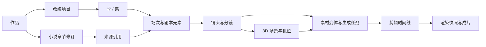
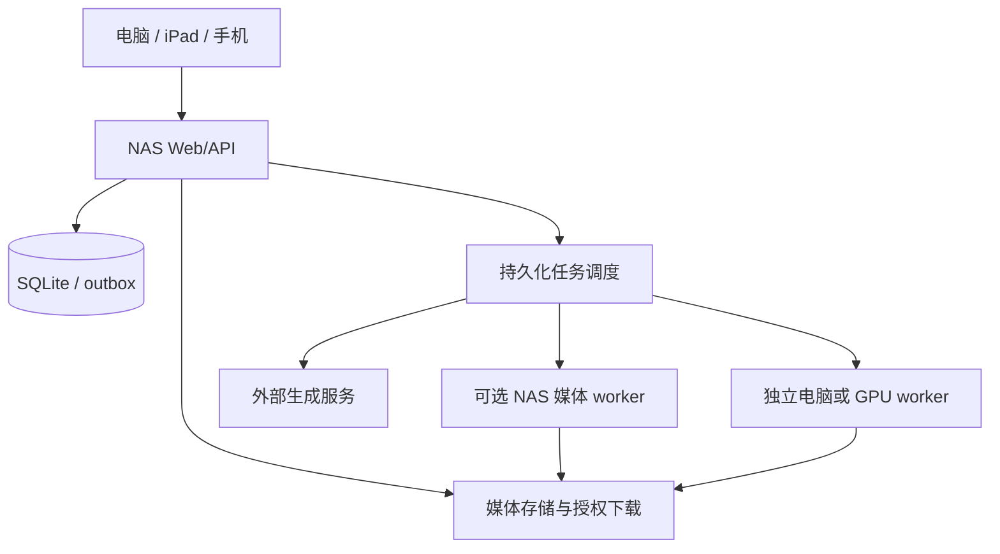

# 从小说到成片的统一系统设计

2026-11-08 用户确认扩大范围。本章记录从小说到成片的目标设计。`0.2.0-dev.15` 已串起小说、剧本、分镜、上传和外部生成素材、基础多轨剪辑及成片导出。 [多轨剪辑开发清单](12-multitrack-editing-checklist.md) · [实施进度](07-implementation-progress.md)

## 产品范围与阶段

同一个作品空间提供小说、改编、分镜、素材、导演台、剪辑和成片入口，共享人物、场景、版本、任务与权限。长篇小说、剧本改编、短剧和漫剧制作均属于总体交付目标。按阶段建设，每阶段有可独立验收的成果。

| 阶段 | 能力 | 可验收产出 |
| --- | --- | --- |
| A 小说工作区 | 设定、人物、蓝图、写稿、审稿、修稿、自动保存 | 多设备可持续编辑的作品 |
| B 剧本与分镜 | 改编项目、季/集/场、对白/动作、分镜列表与画布 | 从指定章节生成并人工确认一集剧本与镜头表 |
| C 成片闭环 | 素材上传与生成、旁白配音、字幕、基础多轨剪辑、渲染导出 | 一段有画面、声音、字幕的可下载成片 |
| D 制片增强 | 3D 导演台、机位运镜、预演、精细音视频编辑、批量制作 | 3D 构图参考进入镜头生成并完成批量制片 |

短剧支持连续视频镜头和对白表演。漫剧支持静帧、分层图片、平移缩放、旁白与字幕，允许在 C 阶段率先形成轻量成片路径。D 阶段属于已纳入的完整产品范围。

## Reveric 实现参考

沿用本地 e3408d8 基线，本轮补查以下代码。复用领域概念和约束，在 Web 栈中实现适配，源码移植遵循 05 文档的逐文件许可证核对。

- [剧本元素](https://github.com/looplj/reveric/blob/e3408d8acf66a50e7ab533c360007f9ff589b12b/lib/shared/models/screenplay_element.dart) 定义场景标题、动作、人物、对白、括注、转场、字幕和注释。
- [场次创建](https://github.com/looplj/reveric/blob/e3408d8acf66a50e7ab533c360007f9ff589b12b/lib/shared/services/screenplay_create_orchestrator.dart) 预校验输入，并组织场次、正文、人物及变更记录的原子创建。
- [分镜服务](https://github.com/looplj/reveric/blob/e3408d8acf66a50e7ab533c360007f9ff589b12b/lib/shared/services/storyboard/service.dart) 将归属、提示词和制作设置校验纳入事务。
- [剪辑渲染](https://github.com/looplj/reveric/blob/e3408d8acf66a50e7ab533c360007f9ff589b12b/lib/shared/services/editing/render_service.dart) 包含 FFmpeg runner、分块预览、缓存及烧录字幕/SRT 导出模式，同时依赖 Dart 文件与 Flutter 服务。
- [导演台导出](https://github.com/looplj/reveric/blob/e3408d8acf66a50e7ab533c360007f9ff589b12b/lib/shared/services/director/export_task.dart) 组织逐帧输出、规格检查、取消、暂停与打包，属于需要重新实现浏览器/执行节点适配的原生流程。

这些源码证明相关实现入口存在，Web 功能等价程度需按阶段验证。

## 统一数据模型

新增领域表放在项目库并通过 Web 迁移管理，与现有 Pagekin 表显式关联。大文件存文件系统，数据库保存元数据和引用。

| 实体 | 关键字段与约束 |
| --- | --- |
| Adaptation | 改编类型、目标时长、画幅、风格、来源小说，允许一部小说多个改编 |
| Episode / Scene | 稳定 ID、顺序、地点、内外景、时间、角色引用、剧情目标 |
| ScriptElement | 类型、文本、人物 ID、顺序、revision，保持结构化编辑 |
| SourceBinding | 源资源 ID、revision、文本片段/hash，与目标多对多关联 |
| Shot | 场次、镜头顺序、景别、动作、机位、运镜、预计时长、对白、来源版本 |
| Asset / AssetVersion | 内容 hash、媒体类型、尺寸、时长、采样率、帧率、位置、来源任务与状态 |
| GenerationSpec | 提示词、模型与参数、参考素材版本、种子（若支持）、外部任务 ID、费用记录 |
| Timeline / Track / Clip | 时间线 revision、轨道类型、素材版本、起止时间、裁切、变速、音量和效果 |
| DirectorScene | 场景对象、变换、灯光、机位、关键帧、资源引用和 revision |
| RenderManifest | 固定时间线版本、全部素材版本、字体、输出规格、渲染器版本 |

人物和地点使用作品级稳定身份。角色定妆、声音、服装等作为带版本的制作资料关联人物，支持每个改编的表现差异。关系图谱和伏笔继续引用小说领域。

小说修改后将关联剧本标为“来源已更新”，保留原改编。剧本修改同样标记镜头需要复核。用户选择重新生成范围，已确认资产和已发布成片保持版本引用。删除采用软删除与引用检查，资产清理在无引用且超过保留期后独立执行。

## 端到端操作

1. 选择小说章节及修订，创建改编项目并设置类型、单集长度与画幅。
2. AI 生成分集提纲、场次和对白候选，作者比较并确认。
3. 从确认的场次生成镜头表，编辑景别、时长、动作和角色参考。
4. 上传或生成图片、视频、配音与音乐。每次生成保留变体，用户选择镜头使用的版本。
5. 将镜头编排到时间线，调整裁切、字幕、旁白、音效与转场，使用低分辨率代理素材预览。
6. 冻结时间线与素材版本，提交渲染，后台完成后预览并下载成片。继续编辑会产生新的时间线修订。
7. D 阶段可在浏览器导演台摆位和设置运镜，导出参考帧或预演片段，继续沿镜头素材链路制作。

AI 工具使用同一领域命令、来源校验与审批机制。创建场次及其正文和人物关联需同事务提交，批量生成按场次或镜头形成可恢复检查点。

## 浏览器编辑与自动保存

小说与剧本沿用 IndexedDB 草稿、停止输入触发、周期保存、版本 CAS 和幂等请求。分镜画布记录对象操作，拖动过程在客户端预览，结束时合并为一次持久化命令。时间线按 clip/track 操作保存，首版采用时间线级 revision，冲突时保存副本并比较。

媒体上传独立于文本保存，采用分片、上传会话、hash 校验与最终确认。只有文件校验并成功登记后才成为可用 AssetVersion。页面显示“文字已保存”“素材上传中”“渲染等待中”等独立状态。

电脑支持完整画布、导演台和多轨剪辑。iPad 支持剧本、分镜与触控基础剪辑，复杂 3D 依据实机能力分级启用。手机优先小说、剧本、镜头卡、素材审核、任务审批和成片预览下载，精细轨道及复杂 3D 使用桌面界面。三端共享同一作品与版本。

## J5005 / fnOS 部署

NAS 承担 Web/API、数据库、媒体文件、任务调度和备份。重计算通过可配置执行节点完成。默认设计假设生图/视频/配音使用外部 API，渲染可在独立电脑节点执行，具体服务与硬件仍待确认。

Compose 的 core 部署应用及数据卷。media profile 可启动独立的 FFmpeg worker，以资源限额执行缩略图、探测、代理和经验证的短片导出。remote worker 使用自己的配置连接 NAS。浏览器保持统一入口，执行位置在任务中可见。

J5005 本机硬件编码是否可用取决于 fnOS 驱动、设备权限、容器构建和目标格式，需要实际探测后决定是否映射 /dev/dri。本方案未承诺硬件编码性能。媒体 worker 默认并发 1，可暂停，CPU/内存限额在确认 NAS 内存后设定。写作 API 保留资源余量。

远程 worker 通过鉴权接口领取任务和访问限定资产，不直接打开 NAS SQLite。执行租约带递增 fencing token，过期 worker 返回结果时不能覆盖新执行。输出先上传暂存并校验，再由 API 事务登记。无可用 worker 时任务明确排队，系统展示缺少的能力。

## 媒体任务与外部费用

统一任务中心按文本生成、图像、视频、音频、代理、渲染分类，分别限流。任务记录 queued、running、awaiting_provider、awaiting_user、succeeded、failed、cancelled、interrupted 等状态。

提交供应商任务后持久化 externalJobId，优先查询已有任务。支持幂等键时传递同一请求身份。提交结果未知且供应商不能查询去重时标为待核对，避免自动重投产生重复费用。取消记录本地意图并尝试取消远端，界面说明实际终止状态。

生成前显示镜头数量、时长及可获取的费用估算，设置任务预算。回调验签并去重，轮询可恢复。供应商短期 URL 的素材须下载校验并入库，失败时保留可重试状态。

## 预览、渲染与导出

预览使用缩略图、波形和代理视频，服务端支持授权 Range 读取。成片任务冻结 RenderManifest，检查素材可读、字幕字体、时间范围与输出规格。

时间线使用整数时间刻度并记录有理数帧率，处理可变帧率源时生成规范代理与时间映射。音频裁切和字幕时间由同一时间基准换算。先统一支持受测的编码与效果组合，逐项增加并对比浏览器预览和最终渲染。

已实现的时间线用毫秒记录轨道位置。画面和独立字幕对齐 25 fps，音频在 48 kHz 混音。旁白、音乐和音效按绝对时间定位，镜头字幕可复制为独立区间。第 2 版渲染清单冻结静帧运动、混音参数和字幕输出方式，旧清单仍由渲染器读取。

渲染调用参数化进程接口，文件路径来自受控资源 ID。输出写临时目录，通过媒体探测、时长及音轨检查后原子登记为成片。失败保留诊断和可恢复任务。支持 MP4 成片、字幕烧录或 SRT、项目清单导出，具体编码器由部署镜像能力检查决定。

D 阶段的 3D 浏览器渲染器需专项原型，验证模型加载、姿态、机位、动画采样与截图。批量逐帧导出交给具备对应渲染能力的 worker，保留引擎版本与采样参数。Flutter 渲染实现需要重新适配。

## 媒体存储与备份

按原始资产、代理缓存、临时上传、渲染临时文件和最终成片分类设置配额。原始资产、采用的变体、字体和 RenderManifest 纳入备份，代理缓存可重建。检查空间预留，达到阈值暂停大任务并提示。

数据库备份对应不可变资产清单，恢复时校验 hash 和缺失引用。外部节点本地临时文件仅作执行缓存。日志记录任务身份和错误，凭据与完整私人内容按既有脱敏规则处理。

## 交付验证与工作量

验收从一份实际章节样例出发，完成剧本、镜头、静帧漫剧和视频短剧两条链路。检查多设备修改冲突、来源变化、素材断点上传、供应商重复回调、worker 崩溃与过期结果、渲染取消、字幕中文字体、音画同步、变速裁切、画幅变化、磁盘满和全项目备份恢复。

每阶段验收门槛如下。

- B 能逐场保存和恢复，原文改变可定位受影响的剧本及镜头。
- C 在浏览器完成素材选择、基础剪辑与导出，NAS 重启后任务和资产引用一致，实际样片可正常播放。
- D 从 3D 场景生成可复现的参考帧并用于制作，批量任务支持失败恢复和预算控制。

原 10～18 人周只作为小说阶段的历史粗估。完整制片范围需要增加剧本、画布、媒体适配、执行节点、剪辑渲染及 3D 专项工作，待 B/C/D 各自原型完成后重新估算，当前不将旧工期套用于整个系统。
